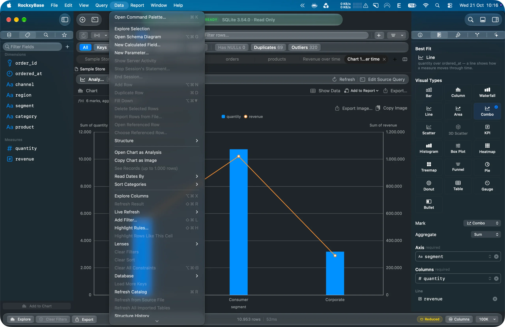
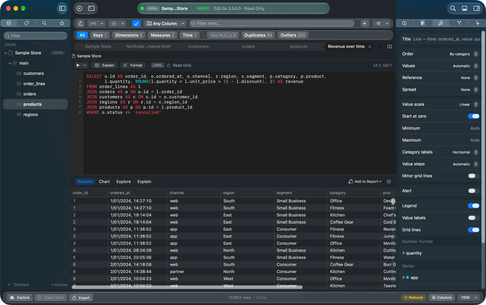
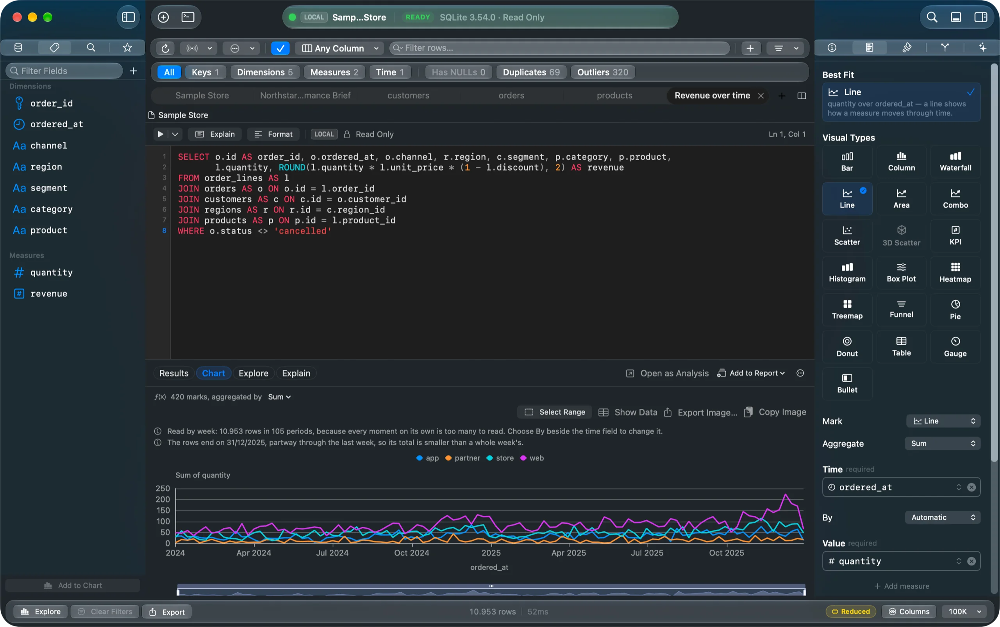
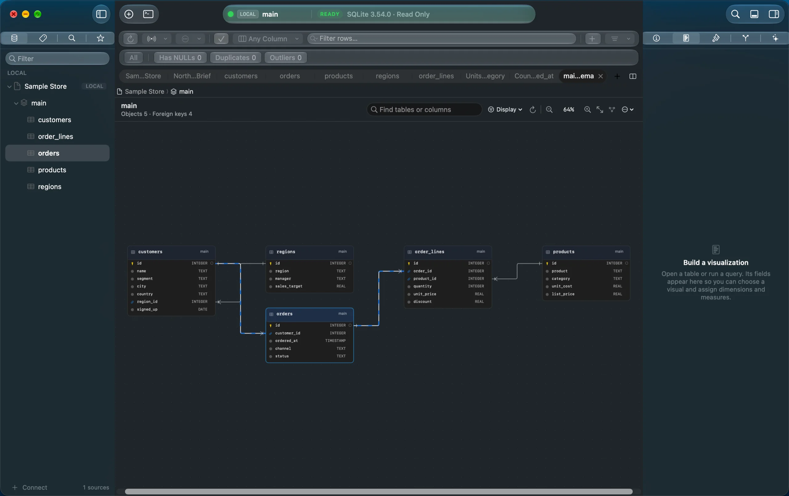
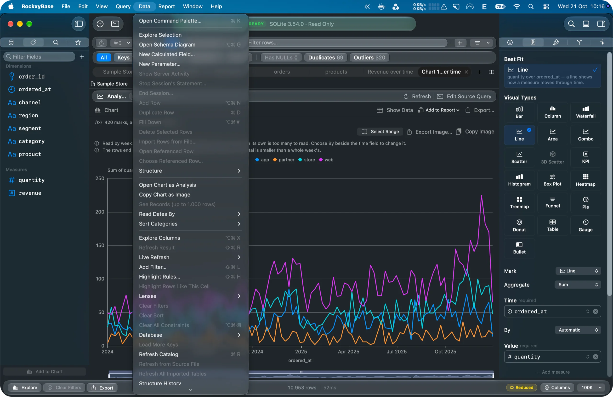
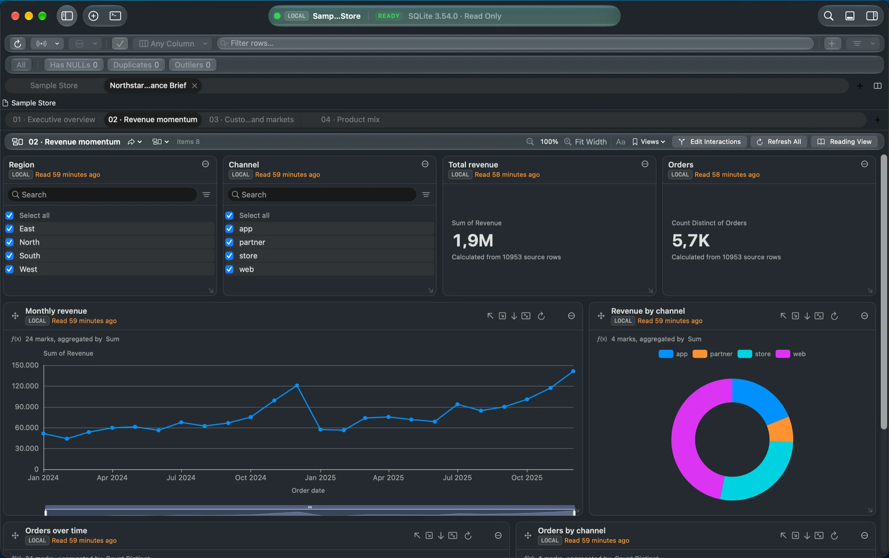
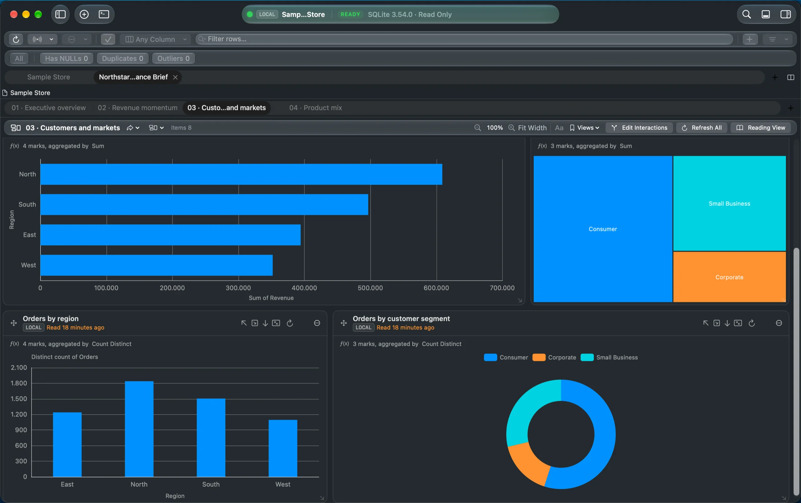
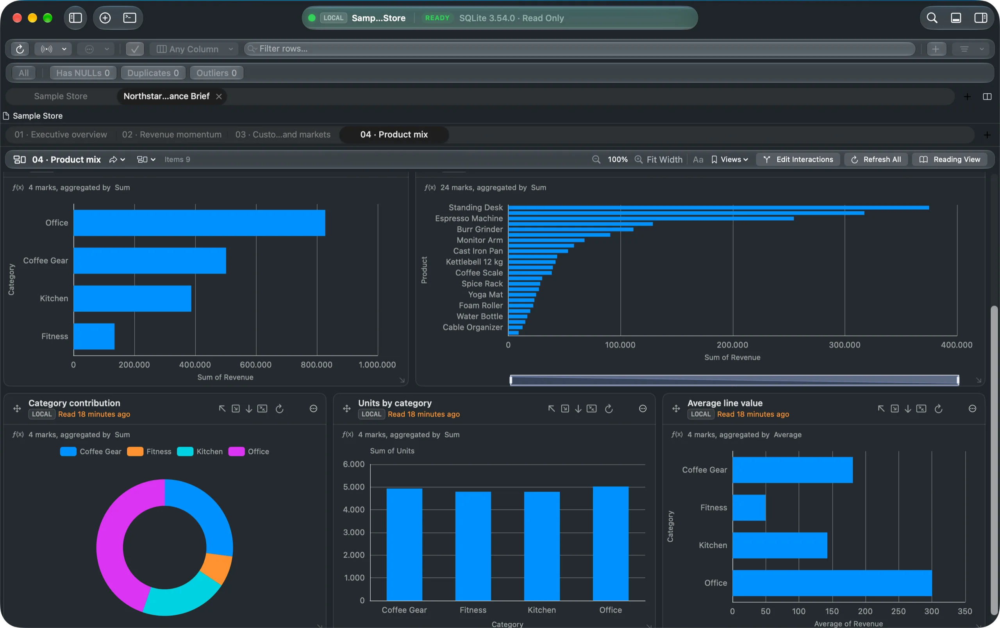
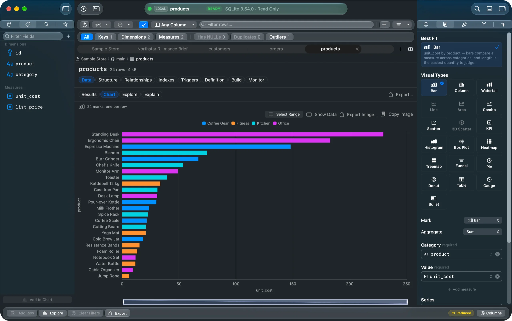

# RockxyBase

**The native data workspace for Mac — from database to insight.**

*Explore database results and configure charts in the same workspace. Screenshot uses Sample Store demo data.*

RockxyBase connects to your databases, lets you query and explore them, model what the
numbers mean, and turn them into charts and reports — in one native macOS app, without a
browser, a server or a cloud account in between.

> RockxyBase is proprietary software. This repository contains no source code. It is where
> releases are published, where the in-app updater reads its release feed, and where you
> can report a problem or ask for a feature.

## Download

**RockxyBase 0.2.0 (build 12)** is available as a public Mac beta. [Download the signed DMG](https://github.com/RockxyApp/RockxyBase/releases/download/v0.2.0/RockxyBase-0.2.0-12.dmg) or read the [release notes](https://github.com/RockxyApp/RockxyBase/releases/tag/v0.2.0).

For newer builds, check [Releases](https://github.com/RockxyApp/RockxyBase/releases).

**Requires** macOS 26.5 or later.

## What it does

- **Connect** to PostgreSQL 17 (including Supabase and Neon) and Microsoft SQL Server 2022,
  over TLS by default, directly or through an SSH tunnel. Credentials stay in the macOS
  Keychain.
- **Query** in a native SQL editor with completion, plans, transactions and cancellation,
  and read results in a fast, native grid.
- **Explore** any table or result: profiles, distributions and outliers, computed by the
  database.
- **Model** the data once — relationships, measures, calculated fields — and ask questions
  of the model instead of writing every join by hand.
- **Visualize** with native charts and build **reports** with pages, slicers, drill-down and
  cross-filtering.
- **Import** CSV and Excel files into a local database you can query and chart.
- **Stay safe** on production: read-only connections are enforced below the interface, and
  changes are previewed before they run.

## A look inside

These screenshots use the **Sample Store** demo data shown on the RockxyBase website.

### Work with database data

Write SQL and inspect the returned rows in one workspace.

Move from a query result into a chart, then inspect how tables relate on the schema canvas.

Find database and analysis tools from the Data menu.

### Build charts and reports

Start with a focused chart, compare related views, and bring them into a report.

The Product Mix report brings category, product, and revenue views together.

## Feedback

- **Found a bug?** Follow the [bug reporting guide](BUG_REPORTING.md), then [open a bug report](https://github.com/RockxyApp/RockxyBase/issues/new?template=bug_report.yml).
- **Want something?** [Request a feature](https://github.com/RockxyApp/RockxyBase/issues/new?template=feature_request.yml).
- **Security issue?** Please do not open a public issue — see [SECURITY.md](SECURITY.md).

When you report a problem, please never include passwords, connection strings, private
hostnames or real data from your databases.

## License

Copyright © 2026 Rockxy LLC. All rights reserved. See [LICENSE](LICENSE).

Part of the [Rockxy](https://rockxy.io) family of Mac apps.
